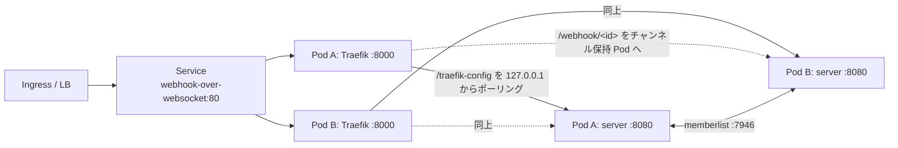

# Kubernetes example (Traefik sidecar)

`webhook-over-websocket` を複数レプリカで動かし、各 Pod に Traefik をサイドカーとして同居させる構成のサンプルです。



## 構成

Kustomize の base / overlay 構成です。

```
example/kubernetes/
├── base/
│   ├── kustomization.yaml   # Deployment, Service と Traefik 設定の configMapGenerator
│   ├── deployment.yaml      # server コンテナ + Traefik native sidecar
│   ├── service.yaml         # 外部公開用 ClusterIP Service と memberlist 用 headless Service
│   └── traefik/
│       ├── static.yaml      # Traefik 静的設定 (HTTP Provider → 127.0.0.1:8080)
│       └── dynamic.yaml     # フォールバック用の動的設定 (/new, /auth/* などをローカルの server へ)
└── overlays/
    └── dev/
        ├── kustomization.yaml   # namespace、イメージタグ、レプリカ数の上書き
        └── namespace.yaml
```

| ファイル                   | 内容                                                                                        |
| -------------------------- | ------------------------------------------------------------------------------------------- |
| `base/deployment.yaml`     | `server` コンテナ + Traefik native sidecar (`initContainers` + `restartPolicy: Always`)      |
| `base/service.yaml`        | 外部公開用 ClusterIP Service (→ Traefik :8000) と memberlist 用 headless Service              |
| `base/traefik/*.yaml`      | Traefik の設定。`configMapGenerator` で ConfigMap 化され、変更するとハッシュ付きの名前が変わって Deployment が再ロールアウトされる |
| `overlays/dev/`            | namespace の作成、イメージタグの固定 (`images`)、レプリカ数 (`replicas`) の上書き例           |

### リクエストの流れ

1. Ingress などから Service 経由で、いずれかの Pod の Traefik サイドカーに届く
2. Traefik は同じ Pod の server から 2 秒ごとに `/traefik-config` を取得している。
   server は memberlist でクラスタ全体のチャンネル情報を集約して返すため、どの Pod の Traefik も完全なルーティング表を持つ
3. `/webhook/<id>` と `/ws/<id>` は、そのチャンネルの WebSocket を保持している Pod の IP (`http://<POD_IP>:8080`) へ転送される
4. それ以外 (`/new`, `/auth/*`, `/healthz`) は `dynamic.yaml` のフォールバックルーターで同じ Pod の server へ転送される

## デプロイ

```bash
# 生成されるマニフェストの確認
kubectl kustomize example/kubernetes/overlays/dev

# 適用
kubectl apply -k example/kubernetes/overlays/dev
```

環境ごとの差分は overlay 側で上書きしてください。`overlays/dev/kustomization.yaml` をコピーして、`namespace` や `images[].newTag`、`replicas[].count` を変えるだけで別環境を作れます。
Traefik の設定を変える場合は `base/traefik/*.yaml` を編集します。ConfigMap 名にハッシュが付くので、適用すれば Pod が自動的に入れ替わります。

Kubernetes 1.29 以降が必要です (native sidecar)。それより古い場合は `initContainers` 配下の `traefik` を `containers` に移動し、`restartPolicy: Always` を削除してください。

外部公開は環境に合わせて Ingress / Gateway API / `type: LoadBalancer` などを `webhook-over-websocket` Service に向けてください。

`--peer-domain` は短い名前 (`webhook-over-websocket-headless`) を指定しているので、overlay で `namespace` を変えてもそのまま動きます。別 namespace の Service を指したい場合だけ FQDN (`webhook-over-websocket-headless.<namespace>.svc.cluster.local`) にしてください。

## 認証を有効にする場合

GitHub OAuth を使う場合は Secret を作成し、`server` コンテナに以下を追加します。

```yaml
args:
  - --github-client-id=$(GITHUB_CLIENT_ID)
  - --github-client-secret=$(GITHUB_CLIENT_SECRET)
  - --github-org=my-organization
  - --jwt-signing-key=$(JWT_SIGNING_KEY)
envFrom:
  - secretRef:
      name: webhook-over-websocket-auth
```

## サイドカー構成と中央 Traefik 構成の比較

`example/memberlist` (Docker Compose) のように Traefik を独立した Deployment で動かす構成も可能です。
どちらも server 側の仕組み (memberlist で集約した `/traefik-config`) は同じで、違いは運用面です。

| 観点                   | サイドカー (このサンプル)                                                | 中央 Traefik Deployment                                                     |
| ---------------------- | ------------------------------------------------------------------------ | --------------------------------------------------------------------------- |
| 管理するリソース       | Deployment 1 つ                                                          | Deployment 2 つ + Traefik 用 Service                                        |
| 設定取得先             | 同じ Pod の `127.0.0.1` (Service に依存しない)                           | Service 経由で任意のレプリカ                                                |
| スケール               | server と常に 1:1                                                        | 独立にスケールできる                                                        |
| リソース               | レプリカごとに Traefik 分が加算される                                    | Traefik は少数で済む                                                        |
| ルーティング表の空白   | Pod 起動直後、最初のポーリングまで (〜2 秒) はフォールバックに落ちる     | Traefik 再起動時のみ                                                        |
| 既に Traefik が Ingress | 二重になる                                                              | Ingress の Traefik に HTTP Provider を足すだけで済み、ホップが 1 つ減る     |

クラスタに既に Traefik Ingress Controller がある場合は中央構成 (Ingress の Traefik に HTTP Provider を追加) の方がシンプルです。
そうでなければ、サイドカー構成は追加コンポーネントなしで完結するため扱いやすい選択肢です。
